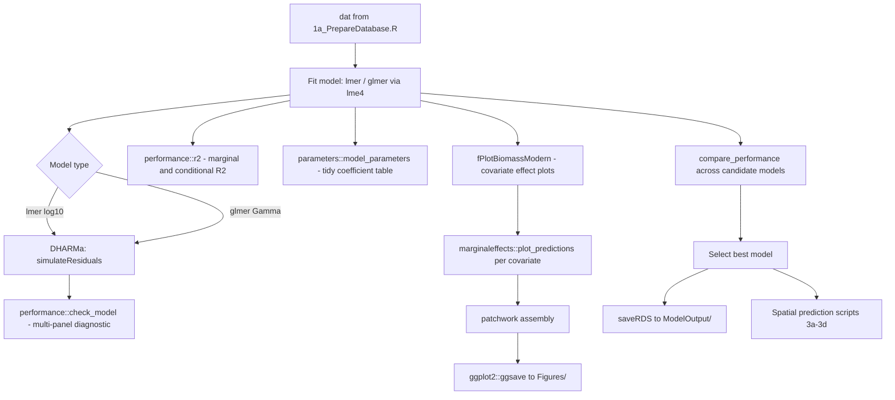

# Modern Statistical Modelling Workflow — AusZooBiomass
**Author:** Jason Everett
**Date:** October 2026
**Status:** Implemented — see `func/fPlotBiomassModern.R` and `ZooBiomassAus_2_StatisticalModels.R`

---

## 1. Context and Goals

The existing modelling code in [`ZooBiomassAus_2_StatisticalModels.R`](../ZooBiomassAus_2_StatisticalModels.R) was written circa 2019 and uses `visreg` (base-R graphics), `MuMIn`, `lattice`, and manual `dev.copy2pdf()` calls. The data preparation is now current (updated September 2026 in [`ZooBiomassAus_1a_PrepareDatabase.R`](../ZooBiomassAus_1a_PrepareDatabase.R)).

**Goals of this modernisation:**

1. Replace `visreg` covariate plots with `marginaleffects` + `ggplot2` + `patchwork`
2. Replace `lattice::qqmath()` / `plot(m1, ...)` diagnostics with `DHARMa` + `performance`
3. Replace `MuMIn::r.squaredGLMM()` with `performance::r2()`
4. Replace `dev.copy2pdf()` with `ggplot2::ggsave()`
5. Add a systematic model comparison framework using `performance::compare_performance()`
6. Provide a **single worked example** at the top of `ZooBiomassAus_2_StatisticalModels.R` that demonstrates the full modern workflow, which can be replicated for future models
7. Write a new `func/fPlotBiomassModern.R` that replaces both `func/fPlotBiomassLM.R` and `func/fPlotBiomassLMERs.R`

**Not in scope:**
- Rewriting the old model blocks (lines 111–212 of `ZooBiomassAus_2_StatisticalModels.R`) — these are legacy and will be left as-is
- Adopting `tidymodels` for core modelling (not appropriate for inferential mixed-effects workflow)
- Changing the model formula structure or random effects

---

## 2. Package Dependencies

### New packages required

```r
install.packages(c(
  "marginaleffects",  # covariate effect plots — replaces visreg
  "performance",      # r2, model comparison, diagnostics
  "parameters",       # tidy coefficient tables
  "see",              # ggplot2 visualisation for easystats
  "DHARMa",           # simulation-based residuals for GLMMs
  "patchwork"         # multi-panel figure assembly
))
```

### Packages to retire (keep for legacy blocks only)
- `visreg` — replaced by `marginaleffects`
- `MuMIn` — replaced by `performance::r2()`
- `lattice` — replaced by `DHARMa` + `performance::check_model()`

### Packages to keep
- `lme4` — core mixed-effects engine, unchanged
- `lmerTest` — p-values for `lmer()`, unchanged
- `splines` — `ns()` basis functions, unchanged
- `utils4mme` — provides `fHarmonic()`, unchanged
- `tidyverse` — data manipulation, unchanged

---

## 3. Workflow Architecture



---

## 4. Specification: `func/fPlotBiomassModern.R`

### Design principles
- **No `grepl()` term detection** — caller explicitly specifies which covariates to plot
- **Returns a `patchwork` object** — caller controls saving, layout, sizing
- **Works with `lm`, `lmer`, `glmer`** — `marginaleffects` handles all three
- **Harmonic terms plotted on human-readable axes** — `HarmTOD` → clock hours, `HarmDOY` → month labels
- **Interactions plotted as faceted or overlaid lines** — not 3D perspective plots
- **All plots use `theme_bw()`** — consistent with rest of project

### Function signature

```r
fPlotBiomassModern <- function(
  model,                    # fitted lm / lmer / glmer object
  covariates,               # named list: list(SST = "SST (°C)", Chl = "Chl-a (mg/m³)", ...)
  interactions = NULL,      # named list of 2-element vectors: list(c("SST", "HarmDOY"))
  re.form = NA,             # passed to marginaleffects: NA = marginalise over random effects
  response_scale = TRUE,    # if TRUE, back-transform predictions to response scale
  ncol = NULL               # patchwork columns; NULL = auto
)
```

### Covariate-specific handling

| Covariate | Special treatment |
|---|---|
| `HarmTOD` | x-axis relabelled: `seq(0, 2π)` → `"00:00"` to `"24:00"` |
| `HarmDOY` | x-axis relabelled: `seq(0, 2π)` → month abbreviations |
| `Chl` | x-axis log10 scale if model uses `log10(Chl)` |
| `Bathy` | x-axis reversed (shallow left, deep right) |
| Factor covariates | `geom_pointrange()` instead of `geom_ribbon()` |
| Interaction pairs | Separate faceted plot using `condition = c(var1, var2)` |

### Output

Returns a `patchwork` object. Caller saves with:

```r
p <- fPlotBiomassModern(m1, covariates = list(...))
ggsave("Figures/Biomass_Nets_Modern.pdf", p, width = 297, height = 210, units = "mm")
```

---

## 5. Specification: Modern Example Block in `ZooBiomassAus_2_StatisticalModels.R`

This block will be inserted **at the top of the script** (after the library/source section), before the legacy model blocks. It uses the Nets LMER as the worked example — the most complex model with a random effect, interaction terms, and harmonic covariates.

### Block structure

```
##### MODERN WORKFLOW EXAMPLE — NETS LMER #####
# This block demonstrates the full modern workflow.
# Replicate this pattern for all future models.
# The legacy model blocks below are retained for reference only.

## 5.1  Fit model
## 5.2  Quick summary
## 5.3  R² (marginal and conditional)
## 5.4  Tidy coefficient table
## 5.5  GLMM residual diagnostics (DHARMa)
## 5.6  Full model diagnostic panel (performance)
## 5.7  Covariate effect plots (marginaleffects + fPlotBiomassModern)
## 5.8  Model comparison (if multiple candidates)
## 5.9  Save model and figure
```

### Key code patterns

**5.3 R²**
```r
library(performance)
r2(m_nets)
# Returns: Conditional R2 (fixed + random) and Marginal R2 (fixed only)
# Replaces: MuMIn::r.squaredGLMM(m1)
```

**5.4 Tidy coefficient table**
```r
library(parameters)
model_parameters(m_nets, effects = "fixed", ci = 0.95)
# Replaces: summary(m1) — returns a tidy data frame, printable as a table
```

**5.5 DHARMa residuals**
```r
library(DHARMa)
sim_resid <- simulateResiduals(m_nets, n = 500, plot = FALSE)
plot(sim_resid)
# For lmer (Gaussian): tests normality of scaled residuals
# For glmer (Gamma): essential — standard residuals are NOT valid for GLMMs
testDispersion(sim_resid)
```

**5.6 Full diagnostic panel**
```r
performance::check_model(m_nets)
# Produces: linearity, homoscedasticity, normality, influential obs, random effects
# Replaces: lattice::qqmath() + plot(m1, sqrt(abs(resid(.))) ~ fitted(.))
```

**5.7 Covariate plots**
```r
source("func/fPlotBiomassModern.R")
p_nets <- fPlotBiomassModern(
  model = m_nets,
  covariates = list(
    BiomassMethod = "Biomass Method",
    Chl           = "Chl-a (mg/m³)",
    Bathy         = "Bathymetry (m)",
    Depth         = "Tow Depth (m)",
    HarmTOD       = "Time of Day",
    HarmDOY       = "Day of Year",
    SST           = "SST (°C)"
  ),
  interactions = list(
    c("HarmDOY", "SST"),
    c("HarmTOD", "Depth")
  ),
  re.form = NA  # marginalise over Gear_Mes2 random effect
)
ggsave("Figures/Biomass_Nets_Modern.pdf", p_nets,
       width = 297, height = 210, units = "mm", device = cairo_pdf)
```

**5.8 Model comparison**
```r
# If comparing multiple candidate models:
compare_performance(m_nets_v1, m_nets_v2, m_nets_v3,
                    metrics = c("AIC", "BIC", "R2_marginal", "R2_conditional", "RMSE"))
# Visual comparison:
plot(compare_performance(m_nets_v1, m_nets_v2, m_nets_v3))
```

**5.9 Save**
```r
saveRDS(m_nets, "ModelOutput/Biomass_Nets_Modern.rds")
```

---

## 6. Handling Harmonic Terms in `marginaleffects`

`fHarmonic()` (from `utils4mme`) returns a matrix of `cos` and `sin` columns. `marginaleffects::plot_predictions()` can vary the underlying `HarmTOD` or `HarmDOY` column directly — the model matrix is recomputed internally.

**Key pattern:**

```r
# Time of day: vary HarmTOD from 0 to 2π, label as clock time
plot_predictions(
  model,
  condition = "HarmTOD",
  newdata = datagrid(HarmTOD = seq(0, 2 * pi, length.out = 200)),
  re.form = NA
) +
  scale_x_continuous(
    breaks = seq(0, 2 * pi, by = pi / 2),
    labels = c("00:00", "06:00", "12:00", "18:00", "24:00")
  ) +
  labs(x = "Time of Day", y = "Biomass (mg/m³)")
```

**Interaction — HarmDOY × SST:**

```r
# Show SST effect at 3 representative DOY values (summer, autumn, winter)
plot_predictions(
  model,
  condition = list(
    SST = seq(5, 30, by = 0.5),
    HarmDOY = c(pi / 6, pi, 5 * pi / 3)  # ~Jan, ~Jul, ~Nov
  ),
  re.form = NA
) +
  scale_colour_manual(
    values = c("firebrick", "steelblue", "goldenrod"),
    labels = c("Summer (Jan)", "Winter (Jul)", "Spring (Nov)")
  ) +
  labs(x = "SST (°C)", y = "Biomass (mg/m³)", colour = "Season")
```

**Interaction — HarmTOD × Depth:**

```r
plot_predictions(
  model,
  condition = list(
    HarmTOD = seq(0, 2 * pi, length.out = 100),
    Depth = c(0, 50, 100, 300, 500)
  ),
  re.form = NA
) +
  scale_x_continuous(
    breaks = seq(0, 2 * pi, by = pi / 2),
    labels = c("00:00", "06:00", "12:00", "18:00", "24:00")
  ) +
  facet_wrap(~Depth, labeller = label_both) +
  labs(x = "Time of Day", y = "Biomass (mg/m³)")
```

---

## 7. Notes on `re.form` in `marginaleffects`

For `lmer`/`glmer` models, `re.form` controls how random effects are handled in predictions:

| `re.form` value | Meaning | Use case |
|---|---|---|
| `NA` | Marginalise over random effects (population-level) | **Default for covariate plots** |
| `NULL` | Include all random effects (BLUPs) | Predictions for observed groups |
| `~0` | Same as `NA` | Alternative syntax |

For covariate effect plots, always use `re.form = NA` so the plot shows the fixed-effect relationship averaged over the random effect distribution, not predictions for a specific gear type.

---

## 8. Files to Create / Modify

| File | Action | Notes |
|---|---|---|
| [`func/fPlotBiomassModern.R`](../func/fPlotBiomassModern.R) | **Create new** | Replaces `fPlotBiomassLM.R` and `fPlotBiomassLMERs.R` |
| [`ZooBiomassAus_2_StatisticalModels.R`](../ZooBiomassAus_2_StatisticalModels.R) | **Add block at top** | Modern example block; legacy blocks untouched |
| [`func/fPlotBiomassLM.R`](../func/fPlotBiomassLM.R) | Keep (legacy) | Referenced by old model blocks |
| [`func/fPlotBiomassLMERs.R`](../func/fPlotBiomassLMERs.R) | Keep (legacy) | Referenced by old model blocks |

---

## 9. Implementation Order

1. **Create `func/fPlotBiomassModern.R`** — the new plotting function
2. **Add modern example block to `ZooBiomassAus_2_StatisticalModels.R`** — at the top, after library/source section, using the Nets LMER as the worked example
3. **Test** — run the example block end-to-end with the current data

---

## 10. Open Questions / Decisions Needed

- [ ] **Which model to use as the worked example?** Recommendation: the Nets LMER (`lmer(log10(Biomass) ~ ... + (1|Gear_Mes2))`) as it is the most representative — has random effects, harmonic terms, and an interaction. The `glmer` Gamma model is also a candidate if you want to demonstrate DHARMa for GLMMs specifically.
- [ ] **Should `fPlotBiomassModern()` save the figure internally, or always return a patchwork object for the caller to save?** Recommendation: always return the object — more flexible, consistent with tidyverse conventions.
- [ ] **Figure dimensions for PDF output?** Current code uses A4 landscape (`paper = "A4r"`). Recommend keeping A4 landscape (297 × 210 mm) as default in `ggsave()` calls.
- [ ] **Should the interaction plots be faceted panels within the main patchwork, or separate figures?** Recommendation: include as additional panels in the same patchwork, clearly labelled.
